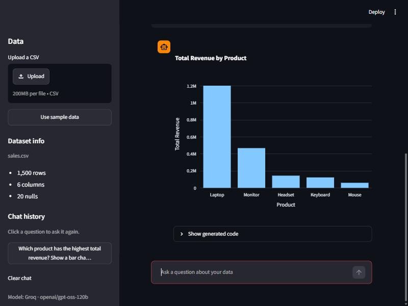

# Data Analyst Agent

Upload a CSV, ask questions in plain English, and get answers as tables, charts or short text. Behind the scenes an LLM agent plans the analysis, writes pandas/Plotly code, runs it in a restricted sandbox, and fixes its own code when it fails.



## How it works

The agent is a LangGraph `StateGraph` with four nodes:

```
START → plan → generate → execute ──success──→ END
                             ↑   └──error──→ fix
                             └──────────────────┘   (up to 3 fixes, then END with the error)
```

| Node | What it does |
|------|--------------|
| `plan` | Reads the question, the dataset schema and recent chat history; describes the approach in 1–2 sentences. |
| `generate` | Writes Python that uses the pre-loaded `df`, `pd`, `px` and `np`, and stores its answer in `RESULT`. |
| `execute` | Runs the code in the sandbox and sorts the result into a table, chart, number or text. |
| `fix` | Reads the traceback and the failing code, and writes a corrected version. |

Every prompt includes the column names, types, sample rows, null counts and numeric stats, so the model doesn't have to guess column names. The last 5 questions, with their code, are passed along too, so follow-ups like "now filter that to 2024 only" work.

## Setup

Needs Python 3.11 or later (built and tested on 3.13).

```bash
python -m venv .venv
```

Activate it: `.venv\Scripts\activate` on Windows, `source .venv/bin/activate` on macOS/Linux. Then:

```bash
pip install -r requirements.txt
```

```bash
cp .env.example .env
```

Open `.env` and add **one** API key:

- **Groq** (recommended): get a free key at <https://console.groq.com/keys> and set `GROQ_API_KEY`. Uses `openai/gpt-oss-120b`, about 2 seconds per call.
- **Gemini**: get a free key at <https://aistudio.google.com/apikey> and set `GOOGLE_API_KEY`. The free tier allows only about 20 requests a day per model, and each question takes 2–5 requests.

If both keys are set, Groq is used. Add `LLM_PROVIDER=gemini` to force Gemini. `GROQ_MODEL` and `GEMINI_MODEL` override the default models (see `src/config.py`).

## Running it

**The web app**

```bash
streamlit run app.py
```

Upload a CSV in the sidebar, or click **Use sample data**. Each answer has a **Show generated code** expander with the plan, the code, and how many fixes it needed. Click a question in the sidebar history to ask it again.

**The walkthrough script** (the same flow, step by step, without the UI)

```bash
python deliverables/walkthrough.py
```

It asks the sample questions below and a follow-up, shows a self-correction, and saves charts and `walkthrough_results.json` to `outputs/`.

**Rebuild the notebook and the PDF report**

```bash
python deliverables/build_notebook.py
```

```bash
python deliverables/generate_report.py
```

`build_notebook.py` turns `walkthrough.py` into `walkthrough.ipynb` and runs it, which makes about 20 live LLM calls and rewrites `outputs/`. `generate_report.py` builds `Project_Report.pdf` from those outputs, so run the walkthrough (or the notebook build) first. The report includes `outputs/app_screenshot.jpg` if it exists; that file is a manual capture of the app.

**Tests** (no API key or network needed; the agent tests use a scripted fake LLM)

```bash
pytest
```

**Regenerate the sample data** (seeded, so the output is the same each time)

```bash
python sample_data/generate_sales.py
```

## Sample questions

`sample_data/sales.csv` has 1,500 rows of sales from 2023–2024: `date, product, region, revenue, quantity, salesperson`, with 20 missing values on purpose. Results from the last live run (Groq, 31 Oct 2026):

| Question | Answer type | Fixes needed |
|----------|-------------|--------------|
| Show the first 5 rows | Table | 0 |
| What's the total revenue? | Number (1,996,526.43) | 0 |
| Revenue by region as a bar chart | Bar chart | 0 |
| Top 3 salespersons by quantity sold | Table (3 rows) | 0 |
| Monthly revenue trend | Line chart | 0 |
| Now filter that to 2024 only *(follow-up)* | Line chart | 0 |
| Which product has the highest average revenue? | Text ("Laptop … 5,031.41") | 0 |
| Compare regions with a pie chart | Pie chart | 0 |
| Show a heatmap of revenue by product and region | Heatmap | 0 |
| Total revenue by product, highest first *(code broken on purpose)* | Table | 1 |

The last row is the self-correction demo: the walkthrough starts it from code with a misspelled column (`'revenu'`), and the `fix` node repairs it from the `KeyError` traceback.

## Project layout

```
Data Analyst Agent/
├── app.py                     # Streamlit UI
├── src/
│   ├── config.py              # API keys, provider and model choice, limits
│   ├── agent/
│   │   ├── graph.py           # StateGraph, retry routing, ask() entry point
│   │   ├── nodes.py           # plan, generate, execute, fix; LLM calls with backoff
│   │   └── state.py           # AgentState TypedDict
│   ├── data/loader.py         # CSV loading, date parsing, schema prompt
│   ├── execution/sandbox.py   # restricted exec() with an AST check and a timeout
│   └── prompts/templates.py   # all LLM prompts
├── deliverables/
│   ├── walkthrough.py         # step-by-step script
│   ├── build_notebook.py      # builds and runs walkthrough.ipynb from the script
│   ├── walkthrough.ipynb      # executed notebook
│   ├── generate_report.py     # builds the PDF from outputs/
│   └── Project_Report.pdf     # architecture, flowchart, sample outputs, learnings
├── sample_data/
│   ├── generate_sales.py
│   └── sales.csv
├── tests/                     # pytest: loader, sandbox, prompts, agent loop, app
├── outputs/                   # walkthrough charts and results (only the app screenshot is in git)
├── requirements.txt
├── .env.example
├── SPEC.md                    # the original project spec
└── IMPLEMENTATION_PLAN.md     # the build plan, phase by phase
```

## Known limitations

- **The sandbox is not a security boundary.** Generated code runs with `exec()` inside the app's own process. An AST check blocks imports, file access, `eval`/`exec`, dunder attributes and similar, only a short list of builtins is available, the code gets a copy of the data, and it has 10 seconds to finish. This stops accidents, not someone who writes code on purpose to break out. Don't expose the app to untrusted users.
- **A timed-out run keeps going in the background.** Python can't kill a thread, so code that hits the timeout is reported as failed but may keep using CPU until it ends.
- **Answers can be wrong without an error.** The fix loop only catches code that crashes. Code that runs but answers a slightly different question looks like a success, so check the plan and code in the expander.
- **Free-tier rate limits.** Groq limits tokens per minute, so a quick burst of questions may show "busy, retrying in N seconds" before it finishes. Gemini's free tier stops after about 20 requests a day per model.
- **One CSV at a time.** No joins across files, and no Excel, JSON or database sources.
- **Large files** are not sampled: the schema prompt is capped in size, but the generated code runs on the whole DataFrame in memory.
- **The PDF report** uses Windows fonts (Arial, Consolas) when they are present and falls back to the built-in PDF fonts elsewhere.
